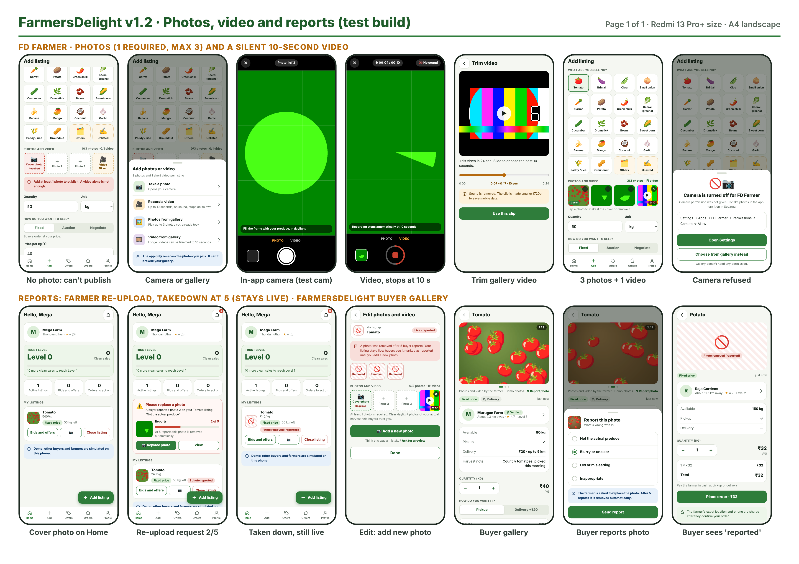
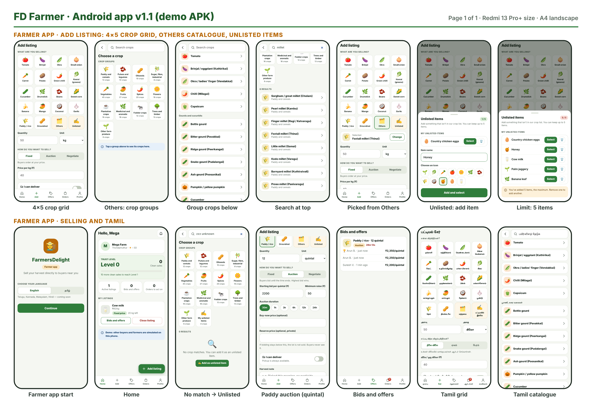
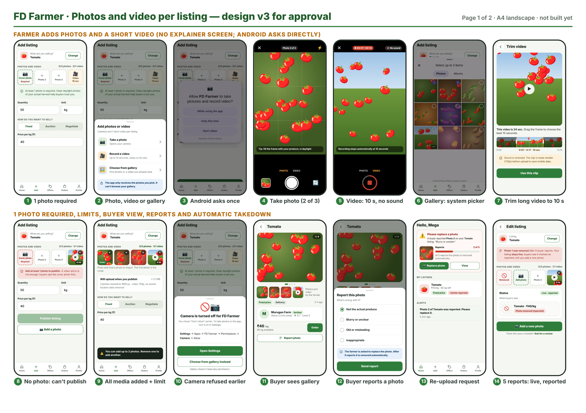
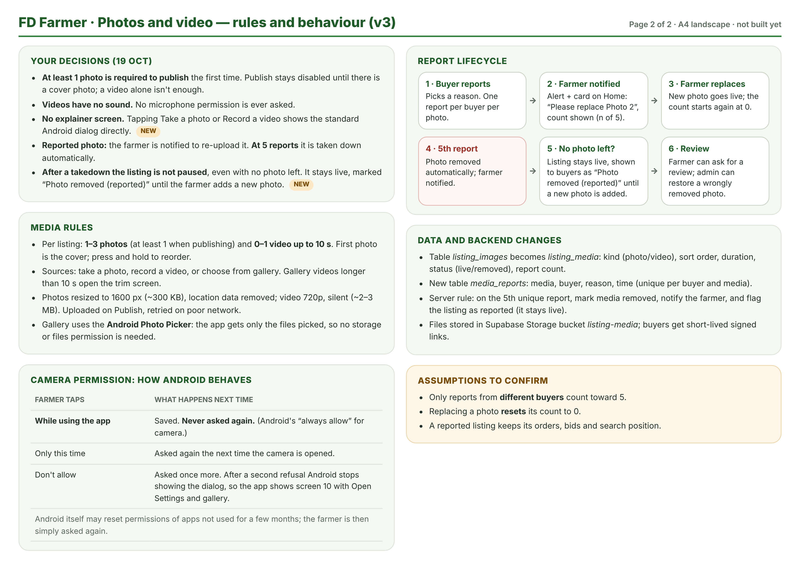
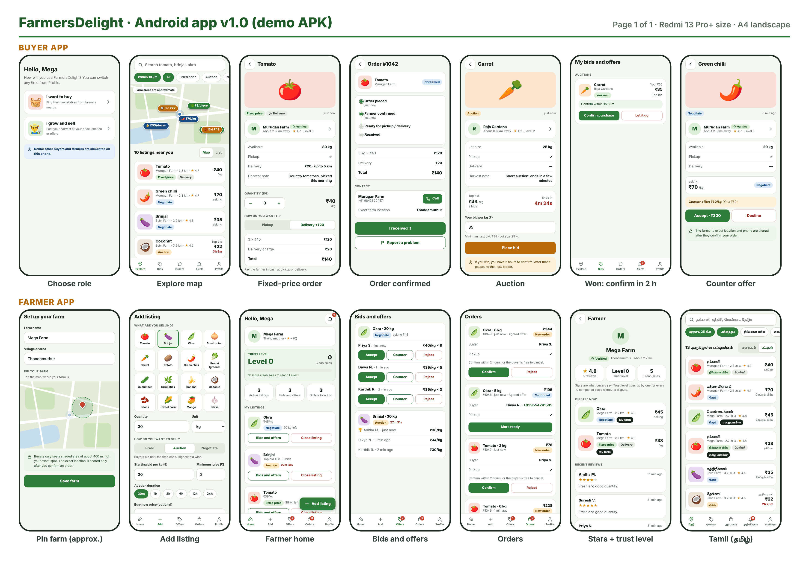
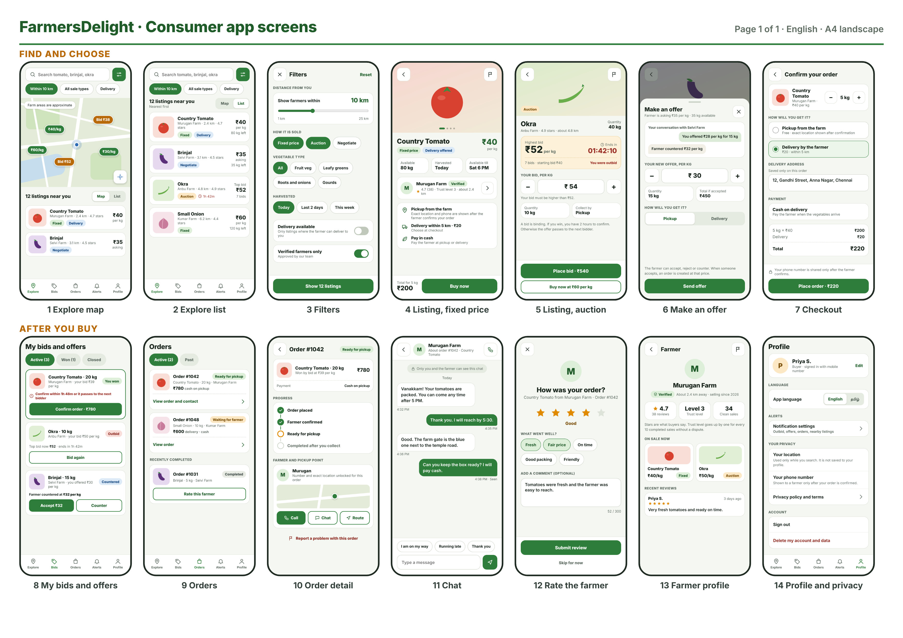

<!-- Generated from docs/source/content.js — edit there and run build.js -->
# FarmersDelight — Product Requirements Document (PRD)

Version 2.0 · 22 October 2026 · Word version: [FarmersDelight_BRD_PRD_v2.0.docx](FarmersDelight_BRD_PRD_v2.0.docx)

## 12. Product overview

|  | FD Farmer | FarmersDelight |
| --- | --- | --- |
| Who | Farmers and sellers | Consumers and buyers |
| Android package | com.farmersdelight.farmer | com.farmersdelight.app |
| Current build | v1.3 (version code 3) | v1.2 (version code 3) |
| Main tabs | Home, Add, Offers, Orders, Profile | Explore, Bids, Orders, Alerts, Profile |
| Permissions | Camera only (asked on first use) | None |
| Minimum Android | 8.0 (API 26); targets API 34 | 8.0 (API 26); targets API 34 |

> **Prototype note**  
> Both prototypes store data only on the phone and simulate the other side of each trade (buyers in the farmer app, farmers in the buyer app). They do not share data yet; that needs the MVP backend. Everything else in this PRD is built and testable unless marked Planned.

## 13. Personas and key journeys

#### Murugan, 46, vegetable farmer near Coimbatore

Uses a mid-range Android phone, prefers Tamil, sells tomatoes and greens. Wants to post a harvest in under two minutes with photos, decide the price, and avoid strangers knowing his exact location until they commit.

#### Priya, 34, home cook in the city

Buys vegetables twice a week, wants to see what she is buying, compare nearby farms, and pick up on the way home or pay a small delivery charge.

### Key journeys

1. Farmer posts a listing: Add → pick crop (grid, Others or Unlisted) → add photos/video → quantity, unit, sale method, price → delivery option → Publish.
2. Buyer buys at fixed price: Explore → listing (gallery) → quantity and pickup/delivery → Place order → farmer confirms → contact revealed → received → rate.
3. Auction: buyer bids → may be outbid → wins → confirms within 2 hours → order; otherwise next bidder.
4. Negotiation: buyer offers → farmer accepts, counters or rejects → order on acceptance.
5. Photo report: buyer reports → farmer asked to replace (n of 5) → farmer replaces, or at 5 reports the photo is removed and the listing stays live as reported.

## 14. Functional requirements

Priority: M = must for MVP, S = should, C = could. Prototype: Built = working in the current APKs; Sim = built with simulated counterpart; Planned = needs the backend or admin panel.

### 14.1 Sign-in and onboarding (both apps)

| ID | Requirement | Priority | Prototype |
| --- | --- | --- | --- |
| ON-01 | Choose language (English, Tamil) on the welcome screen; change any time in Profile. | M | Built |
| ON-02 | Sign in with name and 10-digit Indian mobile number; verify with a 4-digit OTP. | M | Sim (OTP 1234) |
| ON-03 | Each app opens straight into its role; there is no role switch inside an app. | M | Built |
| ON-04 | Farmer sets farm name, village and taps the map to pin the farm; buyers see only an approximate 400 m area. | M | Built |

### 14.2 Farmer: choosing what to sell

| ID | Requirement | Priority | Prototype |
| --- | --- | --- | --- |
| CR-01 | Add listing shows a crop grid of 4 columns × 5 rows: 18 common crops, then Others (19th) and Unlisted (20th, last). | M | Built |
| CR-02 | Others opens a Choose a crop page with Search crops at the top and the 13 crop groups as icons with crop counts. | M | Built |
| CR-03 | Tapping a group shows its crops below the groups; Vegetables keeps its sub-groups (fruiting, gourds, beans, greens, roots, brassicas). | M | Built |
| CR-04 | Search matches crop names, local names in brackets and group names across all groups; no match offers Add as unlisted item. | M | Built |
| CR-05 | Crop names use the Tamil Nadu list text; notes such as “limited/specialised” are shown as a second line. | S | Built |
| CR-06 | Unlisted: farmer adds an item name and picks an icon; up to 5 items; duplicates refused; items can be removed; saved items appear under My unlisted items. | M | Built |
| CR-07 | Units: kg, bunch, piece, dozen, quintal, tonne. | M | Built |

### 14.3 Farmer: photos and video

| ID | Requirement | Priority | Prototype |
| --- | --- | --- | --- |
| MD-01 | Media slots under the crop: Cover photo (Required), Photo 2, Photo 3 and Video (10 sec), with a counter “n/3 photos · n/1 video”. | M | Built |
| MD-02 | Tapping a slot opens Add photos or video with: Take a photo, Record a video, Photos from gallery, Video from gallery. Options are disabled when their limit is reached. | M | Built |
| MD-03 | Take a photo opens the in-app camera with “Photo n of 3”; it closes automatically after the third photo. | M | Built |
| MD-04 | Record a video: a ring shows progress; recording stops automatically at 10 seconds; no sound is recorded. | M | Built |
| MD-05 | Photos from gallery uses the Android picker; several photos can be picked at once; extras beyond 3 are skipped with a message. | M | Built (v1.3 fix) |
| MD-06 | Video from gallery: videos longer than 10 s open Trim video to choose the best 10 seconds; all gallery videos are re-encoded silent at up to 720p. | M | Built |
| MD-07 | Tap a photo to make it the cover or remove it; tap the video to play it; ✕ removes the video. | S | Built |
| MD-08 | Publish is refused without at least 1 photo; the cover slot turns red with “Add at least 1 photo to publish. A video alone is not enough.” | M | Built |
| MD-09 | Edit photos and video of a published listing from Home (camera button) or from a report card. | M | Built |
| MD-10 | Photos and videos survive closing the app (stored on the phone in the prototype; in cloud storage in the MVP). | M | Built / Planned |
| MD-11 | Clear messages for unreadable photos and HEIF/HEIC photos. | S | Built |

### 14.4 Camera permission

| ID | Requirement | Priority | Prototype |
| --- | --- | --- | --- |
| PM-01 | No explainer screen: tapping Take a photo or Record a video shows the standard Android permission dialog directly. | M | Built |
| PM-02 | When the farmer chooses “While using the app”, Android remembers it and the app never asks again. | M | Built |
| PM-03 | If permission is refused, show “Camera is turned off for FD Farmer” with the Settings path, Open Settings and Choose from gallery instead. | M | Built |
| PM-04 | No storage, files or microphone permission is requested. | M | Built |

### 14.5 Selling: sale methods

| ID | Requirement | Priority | Prototype |
| --- | --- | --- | --- |
| SL-01 | Fixed price: buyer chooses quantity and pickup or delivery and places an order. | M | Sim |
| SL-02 | Auction: start bid, minimum raise, duration (30 min to 24 h), optional buy-now price and private reserve. | M | Sim |
| SL-03 | Auction winner confirms within 2 hours or the lot passes to the next bidder. | M | Sim |
| SL-04 | Negotiation: buyer offers price and quantity; farmer accepts, counters or rejects; buyer can accept or decline a counter. | M | Sim |
| SL-05 | Farmer can close a listing; sold-out listings close automatically. | M | Built |

### 14.6 Orders, ratings and trust

| ID | Requirement | Priority | Prototype |
| --- | --- | --- | --- |
| OR-01 | Order states: Placed → Confirmed → Ready → Completed, or Cancelled. | M | Sim |
| OR-02 | Phone and exact location are shown only after the farmer confirms. | M | Built |
| OR-03 | Buyer marks received, then rates 1–5 stars with tags and an optional comment. | M | Built |
| OR-04 | Report a problem marks the order disputed; disputed orders do not count toward trust level. | M | Built |
| OR-05 | Farmer home shows trust level, clean sales and progress to the next level. | M | Built |
| OR-06 | Farmer can request the Verified badge; admin approves. | S | Sim / Planned |

### 14.7 Buyer app

| ID | Requirement | Priority | Prototype |
| --- | --- | --- | --- |
| BY-01 | Explore with map or list, distance filter (5, 10, 25 km), sale-type and delivery filters, and search. | M | Built |
| BY-02 | Listing cards show the cover photo; listings with a removed photo show “Photo removed (reported)”. | M | Built |
| BY-03 | Listing detail has a swipeable gallery (photo count, dots), a video tile that plays, and full-screen photo view. | M | Built (demo photos) |
| BY-04 | My bids and offers, My orders, Alerts and Profile. | M | Built |

### 14.8 Photo reports and takedown

| ID | Requirement | Priority | Prototype |
| --- | --- | --- | --- |
| RP-01 | Report photo on the listing gallery opens Report this photo with reasons: Not the actual produce, Blurry or unclear, Old or misleading, Inappropriate. | M | Built |
| RP-02 | One report per buyer per photo; after reporting, the button shows Reported. | M | Built |
| RP-03 | Farmer Home shows Please replace a photo with the reason, the photo, “n of 5” and Replace photo / View. | M | Built |
| RP-04 | At the 5th report the photo is removed automatically and the farmer is notified. | M | Built |
| RP-05 | If no photo is left the listing stays live, labelled Live · reported for the farmer and “Photo removed (reported)” for buyers, until a new photo is added. | M | Built |
| RP-06 | Farmer can Ask for a review; admin can restore a wrongly removed photo. | S | Planned |
| RP-07 | Demo tools in FD Farmer Profile simulate buyer reports for testing. | C | Built |

### 14.9 Notifications, profile and admin

| ID | Requirement | Priority | Prototype |
| --- | --- | --- | --- |
| NT-01 | Alerts for new bids, offers, orders, outbid, auction won, confirmations, reports and takedowns, with unread badges. | M | Built (in-app) |
| NT-02 | Push notifications through Firebase Cloud Messaging. | S | Planned |
| PF-01 | Profile: language, farm details and pin, verification, privacy summary, sign out, delete account and data. | M | Built |
| AD-01 | Admin web panel: verification queue, reported photos, disputes, restore media, crop list management. | M | Planned |

## 15. Media specification

| Item | Specification |
| --- | --- |
| Photos per listing | 1 to 3 (at least 1 at first publish). First photo is the cover. |
| Accepted photo input | Any photo the phone camera or gallery produces in JPEG, PNG or WebP. HEIF/HEIC is not readable; the farmer is asked to switch the camera to JPEG. |
| Saved photo | JPEG, longest side 1600 px, quality 85%, about 250–500 KB. All metadata including GPS removed. 50 MP (8160×6120) photos are supported and decoded at reduced size. |
| Video per listing | 0 or 1, up to 10 seconds, no sound. |
| Saved video | WebM (VP8/VP9), up to 720p, about 1.8 Mbit/s, roughly 0.7–1 MB for 10 s, plus a JPEG thumbnail. |
| Gallery video longer than 10 s | Trim screen: slider chooses a 10-second window; preview; Use this clip re-encodes the window. |
| Upload (MVP) | On Publish, to Supabase Storage bucket listing-media; retry on poor network; buyers get short-lived signed links. |

## 16. Permissions

| Permission | FD Farmer | FarmersDelight | Why / when |
| --- | --- | --- | --- |
| Camera | Yes | No | Asked the first time the farmer takes a photo or records a video. |
| Microphone | No | No | Videos are silent. |
| Storage / files / media | No | No | Android Photo Picker returns only the chosen files. |
| Location (GPS) | No | No | Farm is pinned by tapping the map; buyer distance uses an approximate area. GPS may be added later as an optional shortcut. |
| Contacts, SMS, call logs | No | No | Never needed. |

## 17. Data model

The v1.0 schema (database/001_schema.sql) defines profiles, farmer_profiles, categories, listings, bids, orders, messages, reviews, reports, notifications and device_tokens, with row-level security, PostGIS location fuzzing and server functions for bids and orders. Version 2.0 adds the tables below (database/002_media_crops_reports.sql).

| Table | Purpose and key columns |
| --- | --- |
| crop_groups | 13 groups: id, name_en, name_ta, icon, sort order. |
| crops | 217 crops: id, group_id, sub_group, name, note (for example “limited”), icon; quick-grid flag and order. |
| farmer_custom_items | Unlisted items: farmer_id, name, icon, hidden; at most 5 visible per farmer (trigger). |
| listing_media | Replaces listing_images: listing_id, kind (photo/video), storage path, thumb path, sort order, duration (≤ 10 s), status (live/removed), report_count. |
| media_reports | media_id, buyer_id, reason, created_at; unique per buyer and media. Trigger removes media at 5 reports and flags the listing as reported (it stays live). |
| listings (changes) | crop_id or custom_item_id; unit adds quintal and tonne; reported flag; publish check requires at least 1 live photo on first publish. |

## 18. Non-functional requirements

| Area | Requirement |
| --- | --- |
| Performance | App opens in under 3 s on a mid-range phone; photo processing under 3 s per photo; trim conversion runs in real time (10 s). |
| Data usage | A full listing (3 photos and 1 video) uploads about 1.5–2.5 MB. |
| Security | OTP auth; row-level security on every table; contact data only via server function after confirmation; signed media links; APKs signed with APK Signature Scheme v2. |
| Privacy | Rules in section 7; delete account removes personal data and media. |
| Localisation | All interface text in English and Tamil; crop group names in both; new languages added through the text table. |
| Accessibility | Touch targets at least 44 px; text size fixed at 100% in the prototype to protect layouts (to be revisited); colour plus text for every status. |
| Compatibility | Android 8.0 (API 26) and later; tested layout at 412×915 dp (Redmi 13 Pro+). |
| Reliability | Media kept if the app is closed; uploads retried; auction timers enforced on the server in the MVP. |

## 19. Acceptance criteria (selected)

| ID | Given / When / Then |
| --- | --- |
| AC-01 | Given the Add listing screen, the crop grid shows exactly 20 tiles in 4 columns and 5 rows, with Others 19th and Unlisted 20th. |
| AC-02 | Given Others, when the farmer types “millet”, then 8 crops are listed across groups; when nothing matches, Add as unlisted item is offered with the search text filled in. |
| AC-03 | Given 5 unlisted items, when the farmer opens Unlisted, then the add form is hidden and “You've added 5 items, the maximum” is shown. |
| AC-04 | Given no photo, when the farmer taps Publish, then the listing is not published and the cover slot shows the required error. |
| AC-05 | Given the video camera, when recording reaches 10 seconds, then it stops automatically and the saved video has no audio track. |
| AC-06 | Given 2 photos already added, when the farmer picks 2 photos from the gallery, then 1 is added and “Extra photos were skipped” is shown. |
| AC-07 | Given a gallery photo with GPS data, when it is added, then the saved photo has no EXIF/GPS data and its longest side is 1600 px. |
| AC-08 | Given camera permission granted with “While using the app”, when the farmer opens the camera again, then no permission dialog appears. |
| AC-09 | Given a photo with 4 reports, when a 5th buyer reports it, then it is removed, the farmer is notified, and the listing stays live (marked reported if no photo is left). |
| AC-10 | Given a buyer who reported a photo, when they open Report photo again for that photo, then Send report is replaced by Reported. |

## 20. Test status

Automated click-through tests run in Chromium at the Redmi 13 Pro+ screen size (412×915) with a simulated camera. Results for the current builds:

| Check | Result |
| --- | --- |
| Onboarding, explore, orders, auctions, offers, reviews (both apps) | Pass, no script errors |
| Crop grid 4×5, Others catalogue (13 groups, 217 crops), search, unlisted limit 5 | Pass |
| Camera photo, 10-second silent video, auto-stop | Pass: 10.0 s, about 740 KB, no audio track |
| Gallery multi-pick including two 50 MP photos | Pass: saved at 1600 px, about 450–480 KB, EXIF/GPS removed |
| Gallery video 24 s trimmed to 10 s | Pass: about 900 KB, audio removed |
| Publish without photo refused | Pass |
| Reports: re-upload card, takedown at 5, listing stays live, replace clears flag | Pass |
| Camera refused path | Pass (simulated refusal) |
| APK structure, manifest, DEX and v2 signature checks | Pass for both APKs |
| On a real Android phone | v1.2 installed and ran on Redmi 13 Pro+ (Android 16). Gallery multi-pick bug found and fixed in v1.3; v1.3 to be confirmed on the device. |

## 21. Next steps

1. Confirm FD Farmer v1.3 on the Redmi: gallery multi-pick and camera photos.
2. Set up the Supabase project; apply schemas 001 and 002; configure OTP SMS and the listing-media bucket.
3. Build the production apps in Flutter against the backend, reusing the screens and rules in this document.
4. Build the admin panel for verification, reported photos and disputes.
5. Have a native speaker review all Tamil text.
6. Choose the pilot district and recruit pilot farmers and buyers.

# Screens (A4 landscape sheets)

All sheets are also in the designs folder of the repository at full resolution (3508×2480, 300 dpi).

**A1. v1.2 built screens: photos, video, reports and buyer gallery**

**A2. FD Farmer: 4×5 crop grid, Others catalogue and Unlisted items**

**A3. Approved design v3: photos and video per listing**

**A4. Approved design v3: rules and behaviour**

**A5. v1.0 prototype screens (buyer and farmer)**

**A6. Consumer app design (14 screens)**

## Appendix B. Crop catalogue summary

| Group | Tamil | Crops |
| --- | --- | --- |
| Paddy and cereals | நெல் மற்றும் தானியங்கள் | 12 |
| Pulses and legumes | பருப்பு வகைகள் | 12 |
| Oilseeds | எண்ணெய் வித்துக்கள் | 10 |
| Sugar, fibre, industrial | கரும்பு, நார், தொழில் பயிர்கள் | 8 |
| Vegetables (6 sub-groups) | காய்கறிகள் | 45 |
| Fruits | பழங்கள் | 27 |
| Spices | மசாலா பயிர்கள் | 20 |
| Flowers | பூக்கள் | 18 |
| Plantation crops | தோட்டப் பயிர்கள் | 16 |
| Medicinal and aromatic | மூலிகை, நறுமணப் பயிர்கள் | 18 |
| Fodder crops | தீவனப் பயிர்கள் | 12 |
| Trees and timber | மரப் பயிர்கள் | 13 |
| Other farm produce | பிற பண்ணைப் பொருட்கள் | 6 |
| Total |  | 217 |

Quick grid (18): Tomato, Brinjal, Okra, Small onion, Carrot, Potato, Green chilli, Keerai (greens), Cucumber, Drumstick, Beans, Sweet corn, Banana, Mango, Coconut, Garlic, Paddy/rice, Groundnut; then Others and Unlisted.

## Appendix C. Glossary

| Term | Meaning |
| --- | --- |
| Clean sale | A completed order with no dispute. |
| Trust level | floor(clean sales ÷ 10); shows reliability. |
| Cover photo | The first photo of a listing, shown on cards and as the first gallery image. |
| Unlisted item | A product a farmer adds that is not in the crop list; up to 5 per farmer. |
| Takedown | Automatic removal of a photo after 5 buyer reports. |
| Live · reported | Listing state after its last photo was taken down: still visible and orderable, marked for buyers until a new photo is added. |
| Android Photo Picker | System screen that lets the user choose photos or videos and gives the app only those files, without storage permission. |

